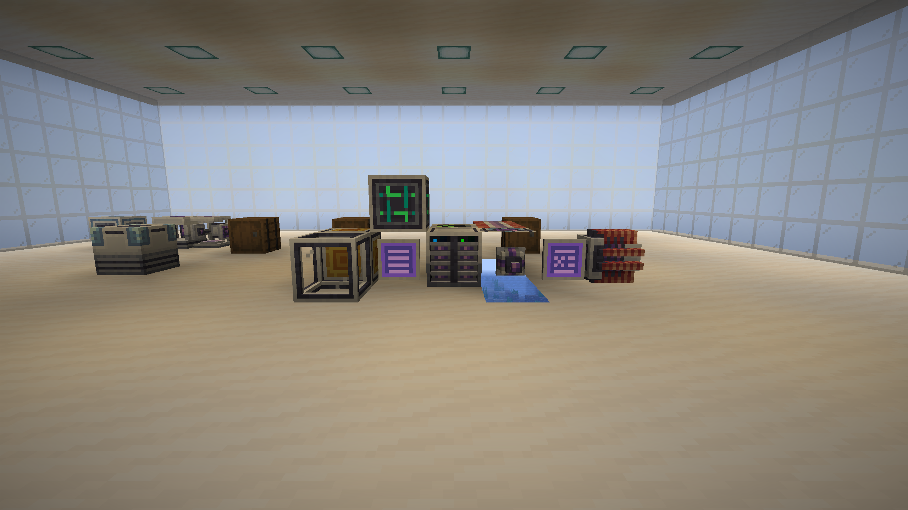
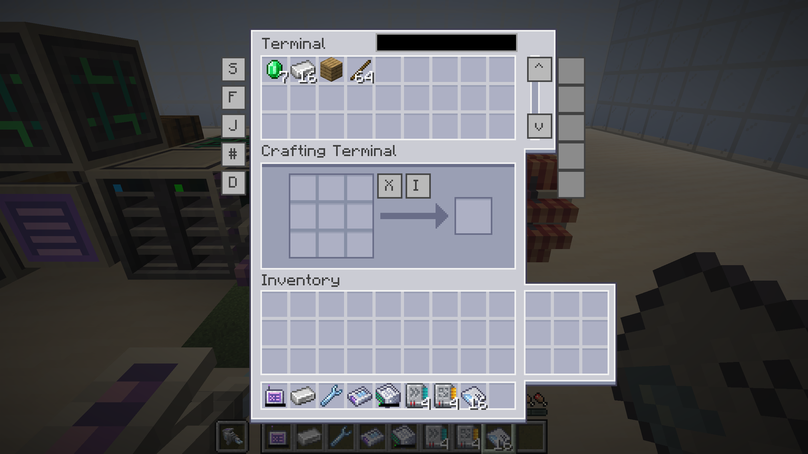

# AE2 for Horizon

An experimental, unofficial native Rust integration of [Applied Energistics 2](https://github.com/AppliedEnergistics/Applied-Energistics-2) with [Horizon](https://github.com/ludovic111/horizon), the Rust Minecraft: Java Edition client.

The project aims to bring AE2's storage, automation, crafting and network systems into Horizon. It is a work in progress, not an official release from either upstream project. It is built into a modified Horizon client: it is not a drop-in Java mod `.jar` or Horizon `.hmod`, and it does not run Java modpacks.



*The hall is a command-seeded integration world used to exercise the native implementation. It is not a bundled save or evidence of complete AE2 parity.*

## About

AE2 organizes items, fluids, energy and crafting around an ME network. This port follows the pinned AE2 19.2.18 source for Minecraft 1.21.1 while integrating with Horizon's Minecraft 26.3 runtime.

The codebase includes work on:

- ME networks, channels, power, storage cells, Drives, ME Chests and storage buses.
- Terminals, wireless crafting terminals, patterns, crafting CPUs, providers and assemblers.
- Machines, buses, planes, memory cards, upgrades and powered tools.
- Network links, quantum and spatial systems.
- An in-game Guide reader with navigation, images, recipes and 3D scenes.

These areas contain implemented behavior and targeted tests; none is a blanket claim that every upstream feature or interaction is complete. See [project status](docs/STATUS.md) for the evidence and known limits.



*The terminal view is from the same command-seeded world. The displayed virtual stack is a view of network storage. The screenshots include AE2 textures and models by Ridanisaurus Rid and AlgorithmX2 et al.; see [NOTICE.md](NOTICE.md) for attribution and terms.*

## Status

**Experimental; full AE2 parity remains unfinished.** The source comparison now covers persistent AE2 components, cells and patterns, asynchronous crafting, physical machine settings, wireless terminals, links and selected local menus. Coordinated host gates and hidden native-world regressions exercise named behaviors and restart custody, including a 999,999-item processing reservation and partial Provider delivery. See [validation evidence](docs/VALIDATION.md), [project status](docs/STATUS.md) and the parity ledgers for exact scope. Java-world and ATM10 compatibility have not been established. Use a new, disposable world while exploring.

Recent work adds mixed source-cell recovery, recipe-aware machine menus, transactional block/fluid Formation placement and authoritative repository interactions.

The default server-thread gameplay path has the strongest coverage. Provider, terminal/encoding, machine, bus and emitter sessions also have focused hidden in-frame tests; remaining local adapters and source UI details are recorded in the ledgers. Details and the scope of the checks are in [docs/STATUS.md](docs/STATUS.md).

## Build and play

### Requirements

- Rust 1.95, Bun, Git, unzip, Python 3.10 or newer, and JDK 25.
- Your own Minecraft: Java Edition 26.3 installation and matching server JAR.
- An internet connection to fetch dependencies, the pinned AE2 source and NeoForge conventional tag data.
- On Linux, Horizon's upstream prerequisites include the ALSA and udev development headers (for example, `libasound2-dev` and `libudev-dev` on Debian-based systems).

Minecraft game files, prepared resources and generated runtime content are not supplied in this repository. Generate them locally from your own installation. The current development and native-world checks were run on macOS; other platforms have not received equivalent validation.

### Prepare a local build

```sh
git clone https://github.com/AdamAugustinsky/ae2-horizon.git
cd ae2-horizon

rustup toolchain install 1.95.0
bun run scripts/prepare-resources.ts \
  --minecraft-dir "/path/to/your/.minecraft" \
  --server-jar "/path/to/your/26.3-server.jar"
bun run scripts/prepare-content.ts
bun run scripts/build.ts
bun run scripts/play.ts
```

Substitute the paths for your own installation. The content preparation step obtains the pinned AE2 source and NeoForge conventional tag data; it does not make this client a NeoForge mod. Do not commit Minecraft JARs, prepared resources or generated assets.

The tested default build disables audio and controller support. To enable audio in a separate build, use `bun run scripts/build.ts --features audio`; that configuration was not part of the stated native-world checks.

The play command opens a visible title screen with an isolated fresh profile; the illustrated hall is not bundled. To start a new creative test world directly, use:

```sh
bun run scripts/play.ts --world "AE2 Experiment" --creative
```

To run the five core test suites, and optionally the AE2 client and host checks (the latter require prepared Minecraft resources):

```sh
bun run scripts/test.ts
bun run scripts/test.ts --client
```

Native world regressions use hidden windows, isolated profiles and virtual input. They serialize rendering under a shared lease, cap each client at 30 FPS, and assert that its window is invisible, unfocused and does not capture the system pointer:

```sh
bun run scripts/test-world.ts provider-session crafting-alternatives
```

The runner accepts `--content DIRECTORY`, `--in-frame` for supported alternate-runtime cases, and `--build METADATA.json` to select a binary by SHA-256. Logs, transcripts and disposable saves remain in ignored `.local/world-tests/`. The ordinary `play.ts` command above is for an explicitly requested visible session.

The included Horizon tree lives in `ludovic111-horizon-7f8a668/`. Five sibling `ae2-*-core` crates hold shared AE2 logic. [SOURCE_MANIFEST.json](SOURCE_MANIFEST.json) records the pinned upstreams and checkpointed source hashes. See [CONTRIBUTING.md](CONTRIBUTING.md) for development and verification guidance.

## Issues and contributing

Please report defects in [this project's issue tracker](https://github.com/AdamAugustinsky/ae2-horizon/issues), including your commit, operating system, steps, expected and observed behavior, and any relevant log excerpts after removing private information. AE2 and Horizon upstream maintainers cannot support this unofficial integration.

Contributions are welcome. Focus a change on one behavior, explain its upstream reference where relevant, and exercise the affected path. Read [CONTRIBUTING.md](CONTRIBUTING.md) before opening a pull request.

## Licenses and credits

This repository combines work under different licenses. Horizon is MIT licensed; AE2 source-derived code and the AE2 core crates carry LGPL terms. Upstream AE2 textures and models have separate CC BY-NC-SA 3.0 terms, its text and translations are CC0, and the Guide click sound has CC BY 4.0 terms. Generated content also uses NeoForge data. See [LICENSE.md](LICENSE.md), [NOTICE.md](NOTICE.md) and [LICENSES/](LICENSES/) for the applicable notices and exact terms.

Thanks to the [Applied Energistics 2 contributors](https://github.com/AppliedEnergistics/Applied-Energistics-2/graphs/contributors), [Horizon contributors](https://github.com/ludovic111/horizon/graphs/contributors), NeoForge contributors and the creators of the referenced artwork and sounds.

